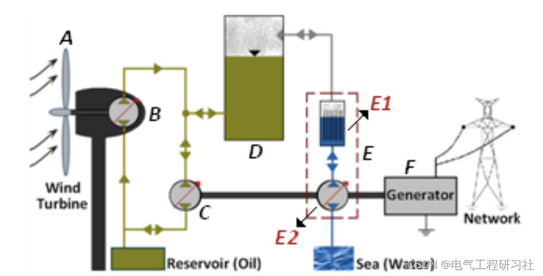
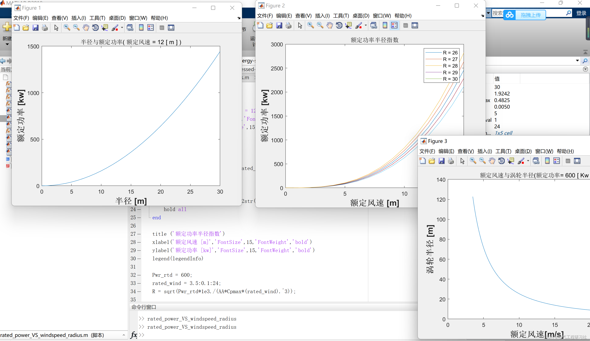
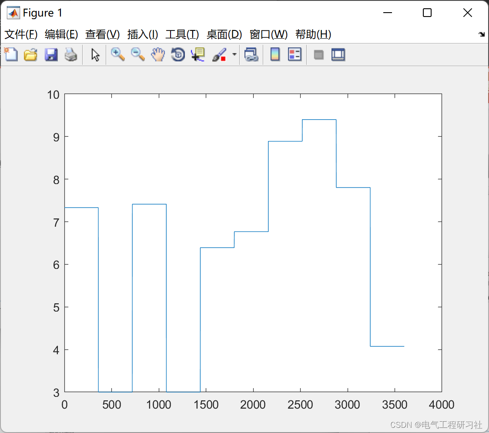
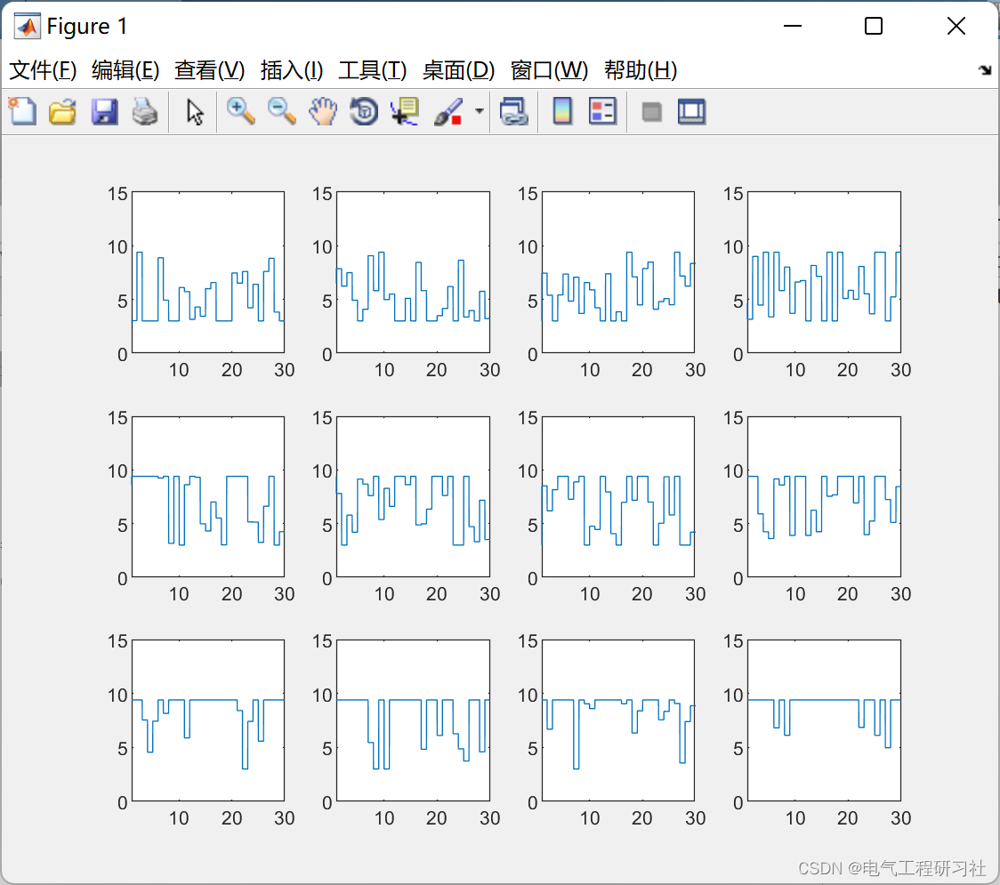
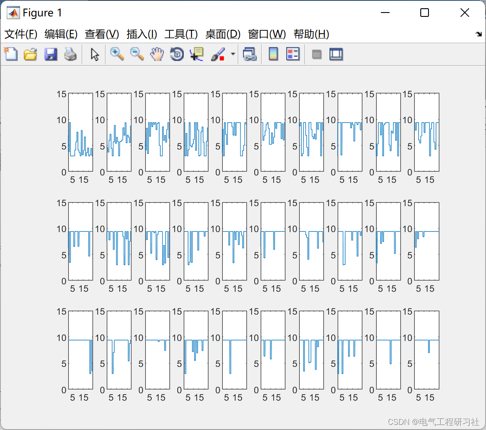
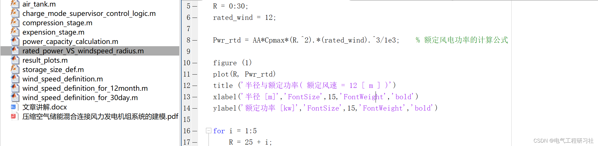

# Modeling and Control of New Offshore Wind Turbine and Compressed Air Energy Storage System (Matlab Code Implementation)

💥💥💥💞💞💞💞 Welcome to this blog❤️❤️❤️💥💥💥
📋📋📋The following is the table of contents.: ⛳️⛳️⛳️​Contents1 Overview2 Mathematical model3 Run Result3.1 Visualized rated power indicators with wind speed and fan radius 3.2 Wind speed 3.3 From Weibull Generate12 Monthly wind speed 3.4 From Weibull Generate 30 Tianfeng speed4 Article explanation andMatlabCode 5 End of the note1 Overview - Renewable energy sources such as wind and solar power are clean, available whenever the wind blows or the sun shines. The two main drawbacks of these sources are their intermittency and their availability often not matching electricity demand. For example, when electricity demand is low, wind power tends to be more abundant at night..Changes in wind speed and solar intensity make integrating wind and solar energy into the grid a challenge. Energy storage systems can provide stable and predictable power by storing excess energy and releasing it when demand exceeds supply.
In this paper, we consider the concept of energy storage in wind turbines, particularly those offshore. Currently, the capacity factor of offshore wind turbines is generally less than 50%. Therefore, the generators, collection, and transmission systems are not fully utilized. Collection and transmission are a major part of balancing costs at offshore wind turbine factories. By storing energy before generating power, the size of electrical components can be reduced to meet demand rather than supply.
[1] proposes a new concept for Wind Turbine Air Compression Energy Storage (CAES) (Figure 1). Storing energy in high-pressure (~200-350 bar) compressed air is attractive because 1) it has relatively high energy density (~ 5MW * 8hr energy can be stored in 500m^3 of seawater at 35MPa), compared to pumped hydro storage (about 144,000m^3); 2) it is scalable (energy capacity scales linearly with the volume of the storage container); 3) it is cost-effective compared to batteries, with a longer lifespan; 4) it does not rely on specific geological locations required by traditional CAES or pumped hydro.
In traditional CAES systems, excess electricity is used to drive air compressors, compressing air into underground salt caverns; then, energy is recovered through precompression and improving the efficiency of natural gas combustion in gas turbines. Such systems have relatively low efficiency (<50%), require carbon-hydrocarbon fuel, and depend on geological locations.
Editorial
Figure 1
2 Mathematical Model
The wind turbine extracts kinetic energy from the swept area of its rotor blades. The air dynamic torque given by the formula below is obtained when the wind speed and the rotor speed ωr on the turbine shaft are known:
where r is the radius of the turbine, P is the power coefficient [6], β is the pitch angle.
A detailed mathematical model is available in Section 4.
3 Operational Results
3.1 Visualization of rated power indicators against wind speed and turbine radius
3.2 Wind Speed
3.3 From Weibull generation of 12-month wind speed
3.4 From Weibull generation of 30-day wind speed
4. Article Explanation and MATLAB Code
This article only showcases a portion of the code, all codes can be found in:  
Edit
figure (1)  \nplot(R, Pwr_rtd)\ntitle ('Radius and rated power( Nominal wind speed = 12 [ m ] )')\nxlabel('Radius [m]','FontSize',15,'FontWeight','bold')\nylabel('Rated power [kw]','FontSize',15,'FontWeight','bold')\n\nfor i = 1:5\n    R = 25 + i;\n    rated_wind = 0:15;\n    Pwr_rtd = AA*Cpmax*R.^2.*(rated_wind).^3/1e3;   % rated power\n  \n    figure(2)  \n    plot(rated_wind, Pwr_rtd)  \n    legendInfo{i} = ['R = ' num2str(R)];  \n    hold all\nend\n\ntitle ('Rated power radius index')\nxlabel('Nominal wind speed [m]','FontSize',15,'FontWeight','bold')\nylabel('Rated power [kw]','FontSize',15,'FontWeight','bold')\nlegend(legendInfo)\n\nPwr_rtd = 600;\nrated_wind = 3.5:0.1:24; \nR = sqrt(Pwr_rtd*1e3./(AA*Cpmax*(rated_wind).^3));\n \nfigure(3)\nplot(rated_wind, R)\ntitle ('Nominal wind speed and turbine radius(Rated power= 600 [ Kw ])')\nxlabel('Nominal wind speed[m/s]','FontSize',15,'FontWeight','bold')\nylabel('Turbine radius [m]','FontSize',15,'FontWeight','bold')\n  
5. Endnotes: The references to theoretical literature are from online sources, and if any infringement occurs, please contact the blogger for removal.

## Images

<!-- PAYMENT_BLOCK -->

## Get this dataset

- Payment link (Stripe): [Buy now](https://buy.stripe.com/3cs8yP7sY87d0vu9AB)
- Payment QR code: 

<!-- /PAYMENT_BLOCK -->
